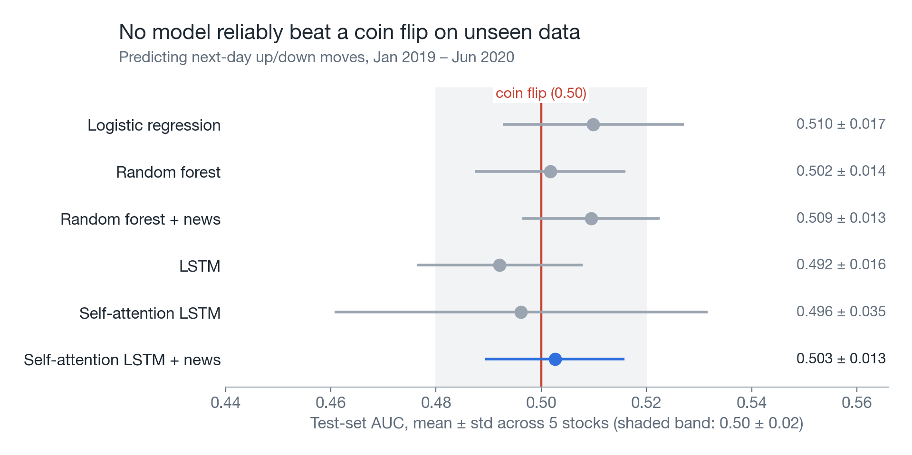
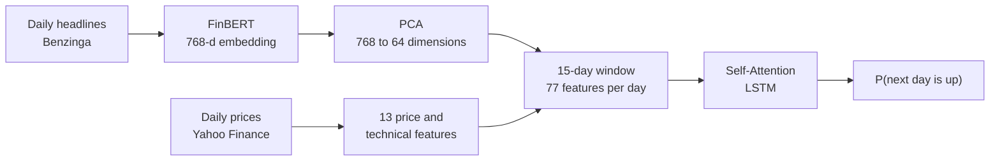
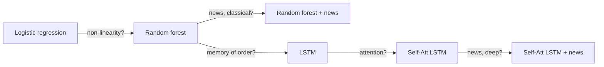
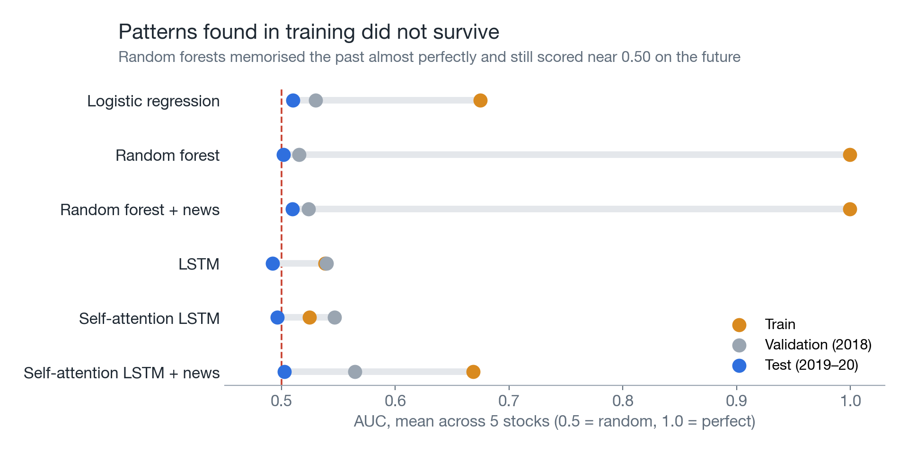
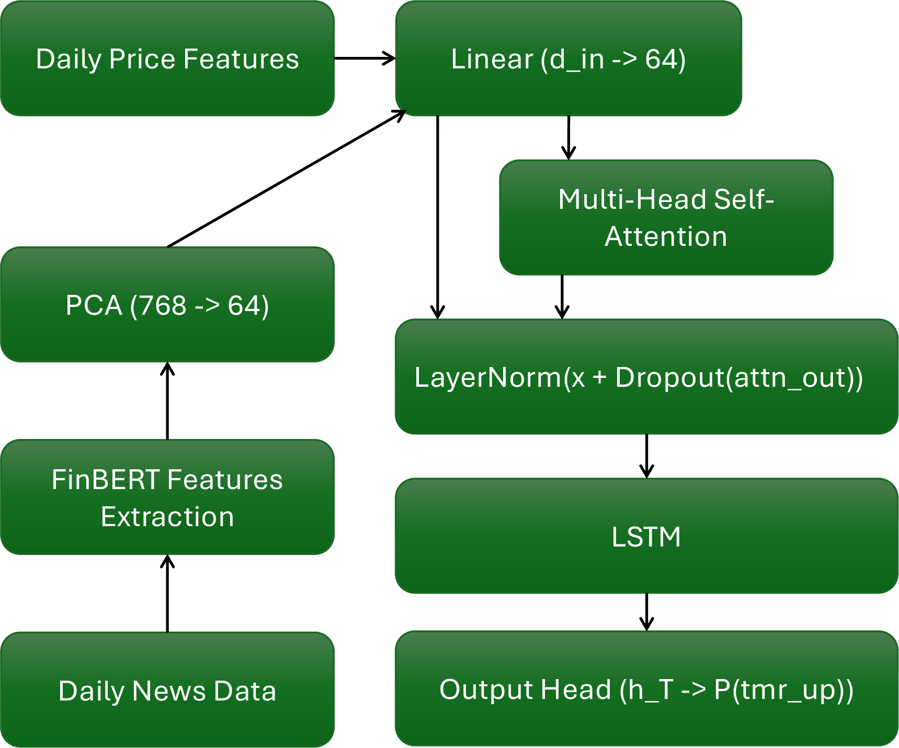
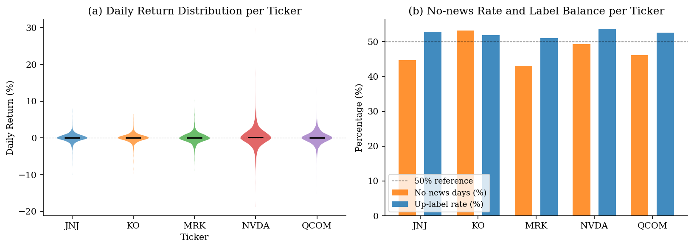
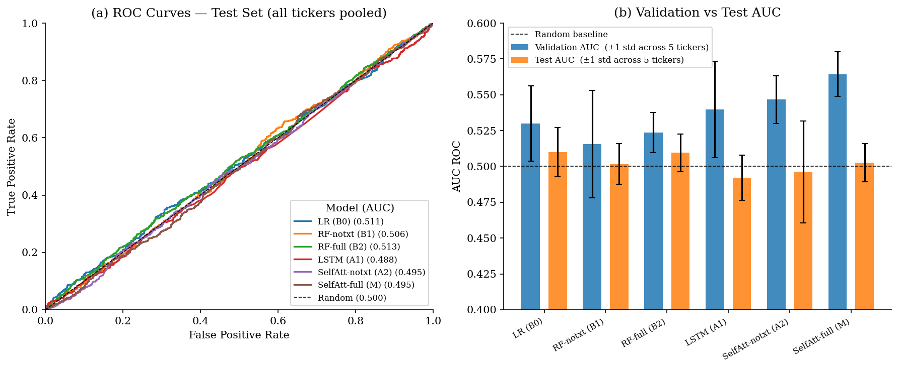
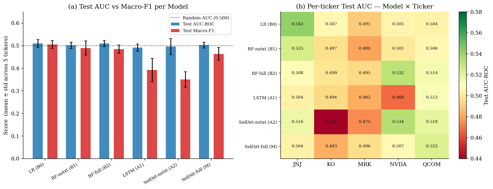
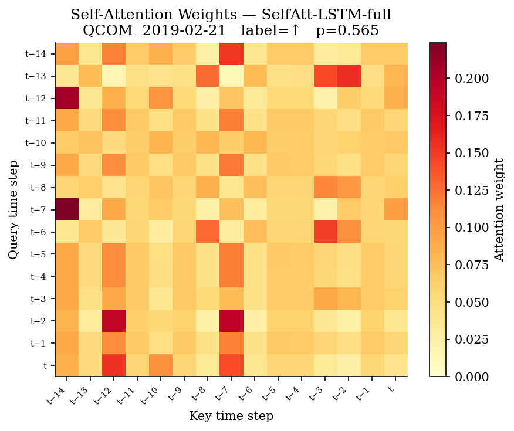

# finbert-attention-lstm

Can financial headlines and recent prices tell you whether a stock will rise or fall tomorrow? This project fuses FinBERT news embeddings with price features in a Self-Attention LSTM, then tests it against five simpler models on MRK, JNJ, KO, NVDA and QCOM.

On data they had never seen, none of the six reliably beat a coin flip. That is consistent with the [efficient market hypothesis](https://en.wikipedia.org/wiki/Efficient-market_hypothesis): public information is largely priced in already.



AUC measures how well a model separates up days from down days: 0.50 is pure guessing and 1.00 is perfect. Each dot is one model's average across the five stocks, and each line shows how much that average varies from stock to stock.

## From headlines to a prediction



The model looks at the last 15 trading days. Self-attention weighs which of those days matter most, and the LSTM then reads them in order.

## Six models, one change at a time

To see what each ingredient contributes, the models form a ladder in which each step changes one thing: non-linearity, memory of order, attention, or news.



| Model | Test AUC | Test macro-F1 | Test accuracy |
|---|---:|---:|---:|
| Logistic regression | 0.510 ± 0.017 | 0.505 ± 0.017 | 0.509 ± 0.014 |
| Random forest | 0.502 ± 0.014 | 0.490 ± 0.031 | 0.513 ± 0.010 |
| Random forest + news | 0.509 ± 0.013 | 0.485 ± 0.018 | 0.511 ± 0.022 |
| LSTM | 0.492 ± 0.016 | 0.393 ± 0.052 | 0.506 ± 0.007 |
| Self-attention LSTM | 0.496 ± 0.035 | 0.351 ± 0.034 | 0.496 ± 0.016 |
| **Self-attention LSTM + news** | **0.503 ± 0.013** | **0.464 ± 0.028** | **0.501 ± 0.013** |

<sub>Mean ± std across 5 stocks, each run with 3 seeds. Source: <a href="results/metrics.json"><code>results/metrics.json</code></a>. Individual stock-and-model scores ranged from 0.437 to 0.542.</sub>

The simplest model did as well as any: logistic regression matched or beat every neural model on test AUC, so temporal modelling added no measurable benefit here.

## Good in training, gone in testing



Random forests overfit severely, with train AUC near 1.0 and test AUC near 0.50, with or without news. Validation AUC also exceeded test AUC for every model, so patterns that looked good in 2018 did not carry into 2019–2020.

The neural models drifted toward predicting one class, with test macro-F1 as low as 0.351. Adding news lifted the self-attention model to 0.464, which suggests text may act as a soft regulariser, but its AUC did not improve in any meaningful way.

## Keeping the future out of the data

Stock prediction demos often look impressive because future information has leaked into training. A null result is only worth reporting if that has been ruled out, so this pipeline enforces:

- **Date-ordered splits.** Train on 2013–2017, validate on 2018 and test on January 2019 to June 2020, with no shuffling across periods.
- **A one-day news lag.** Only news from day *t−1* can predict the return on day *t*.
- **Per-stock scaling and tuning.** Each stock gets its own `MinMaxScaler`, fitted on training rows only, and its own Optuna study.

The result still has a narrow scope: five stocks, one news source, daily data and a single test window that includes the COVID-19 shock. It does not show that news is useless for every asset, horizon or data source. On 47.3% of stock-days there was no news, and those days are represented as zero vectors.

## Reproducing `results/metrics.json`

```bash
conda env create -f environment.yml

# Place the Kaggle Benzinga file at data/raw/news/analyst_ratings_processed.csv

python main.py --all                                       # full pipeline, first run
python main.py --steps train --tune --trials 30 --seeds 3  # tune, then train
```

`main.py` handles step order and skips steps whose outputs already exist. Add `--force` to re-run one. Delete `optuna_studies.db` before the first tuned run so stale studies are not reused.

| Step | Script | Output | Notes |
|---|---|---|---|
| `pipeline` | `src/data_pipeline.py` | `data/processed/features.parquet` | Run once |
| `embed` | `src/embed_news.py` | `data/processed/embeddings_pca.npy` | About 1 hour on CPU |
| `train` | `src/train.py` | `results/metrics.json` | About 29 minutes tuned on Apple M-series, about 1.2 minutes untuned |

## Data, features and architecture

<details>
<summary><b>Prices, news and splits</b></summary>

**Prices:** Yahoo Finance via `yfinance`. MRK, JNJ, KO, NVDA and QCOM, daily OHLCV, 2013-01-01 to 2020-06-30.

**News:** Kaggle Benzinga `analyst_ratings_processed.csv`, filtered to 5,356 (date, ticker) pairs. Headlines are aggregated per (date, ticker), encoded with `ProsusAI/finbert` using the CLS token, then reduced from 768 to 64 dimensions with PCA (85.8% of variance explained).

**Target:** `y = 1` if the next day's close is above today's close. Classes are about 52% up and 48% down.

| Split | Period | Rows |
|---|---|---:|
| Train | 2013-01-31 to 2017-12-29 | 6,195 |
| Validation | 2018-01-02 to 2018-12-31 | 1,255 |
| Test | 2019-01-02 to 2020-06-26 | 1,875 |

</details>

<details>
<summary><b>The 13 price features</b></summary>

| Feature | Group | Description |
|---|---|---|
| `return_1d` | Returns | Daily close-to-close return |
| `return_5d` | Returns | 5-day cumulative return |
| `return_20d` | Returns | 20-day cumulative return |
| `vol_20d` | Volatility | 20-day rolling std of returns |
| `ma_ratio` | Trend | 5-day MA / 20-day MA |
| `rsi` | Oscillator | 14-day RSI |
| `macd_signal` | Oscillator | MACD signal line (EMA 9 of MACD) |
| `vol_change` | Volume | 1-day volume change |
| `turnover_ratio` | Volume | Volume / 20-day average volume |
| `intraday_ret` | Candlestick | (Close − Open) / Open |
| `hl_range` | Candlestick | (High − Low) / Close |
| `upper_shadow` | Candlestick | Upper wick / (High − Low) |
| `lower_shadow` | Candlestick | Lower wick / (High − Low) |

</details>

<details>
<summary><b>Model inputs and the Self-Attention LSTM</b></summary>

| # | Model | Features | Input dim |
|---|---|---|---:|
| B0 | Logistic regression | Price, flat window | 195 |
| B1 | Random forest | Price, flat window | 195 |
| B2 | Random forest + news | Price + FinBERT, flat window | 1,155 |
| A1 | LSTM | Price sequence | 15 × 13 |
| A2 | Self-attention LSTM | Price sequence | 15 × 13 |
| M | Self-attention LSTM + news | Price + FinBERT sequence | 15 × 77 |

```
Input:  (T=15, d_in)    d_in = 13 without text, 77 with text
Linear projection:      d_in → hidden_dim
Multi-head self-attention (Q=K=V):
                        heads ∈ {1,2,4,8}, attn_dropout ∈ [0.0, 0.3]
Residual + LayerNorm
LSTM:                   hidden_dim, layers 1–2, lstm_dropout ∈ [0.1, 0.5]
Linear(hidden_dim → 1) → sigmoid → P(up)
```

Loss: `BCEWithLogitsLoss(pos_weight = n_neg / n_pos)`. Attention weights `(batch, T, T)` are stored after each forward pass for visualisation.



</details>

<details>
<summary><b>Per-ticker training protocol</b></summary>

- **One independent model per ticker per model type**, for example `lstm_MRK`.
- **Each ticker has its own** `MinMaxScaler` (fitted on training rows only), `pos_weight` and Optuna study.
- **Tuning:** Optuna TPE sampler with MedianPruner, 30 trials per model per ticker.
- **Reporting:** 3 seeds per model-ticker pair, with accuracy, macro-F1 and AUC-ROC.
- **Outputs:** `results/metrics.json` holds `per_ticker` and `aggregated` sections, and raw predictions go to `results/predictions/<model>_<ticker>.npz`.

</details>

<details>
<summary><b>EDA, ROC, error analysis and attention figures</b></summary>

**Exploratory analysis: feature distributions and class balance per ticker**



**ROC curves and AUC bar chart, validation vs test**



**Error analysis: per-model summary and per-ticker AUC heatmap**



**Self-attention heatmap for the best ticker (QCOM, 2019-02-21)**



</details>

## Background

This project extends the Self-Attention LSTM framework of Sun et al., *"Stock price prediction with attention-based framework by integrating LLM-generated features"* (ICONIP 2025), from Chinese equities to US stocks, English-language news and a classification target.

<sub>For research and education only. Not investment advice.</sub>
